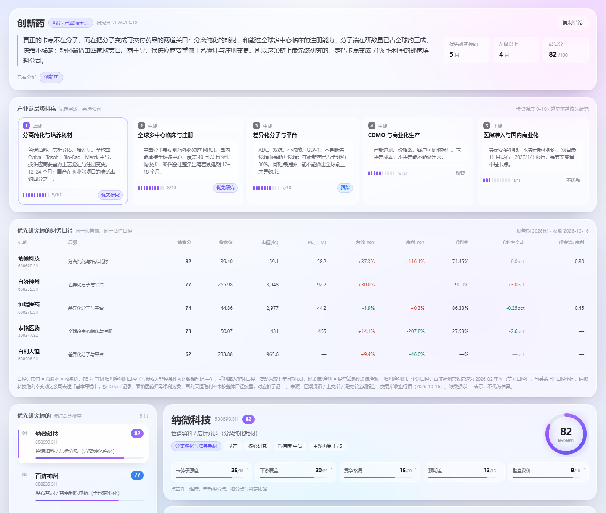
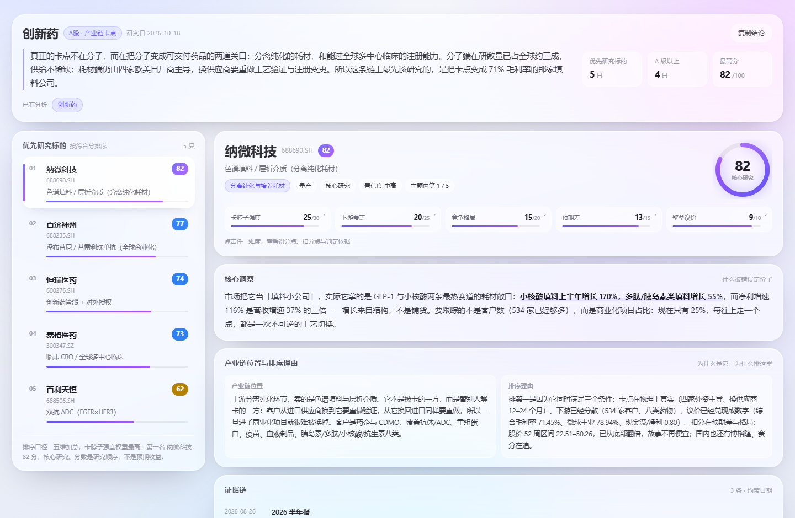
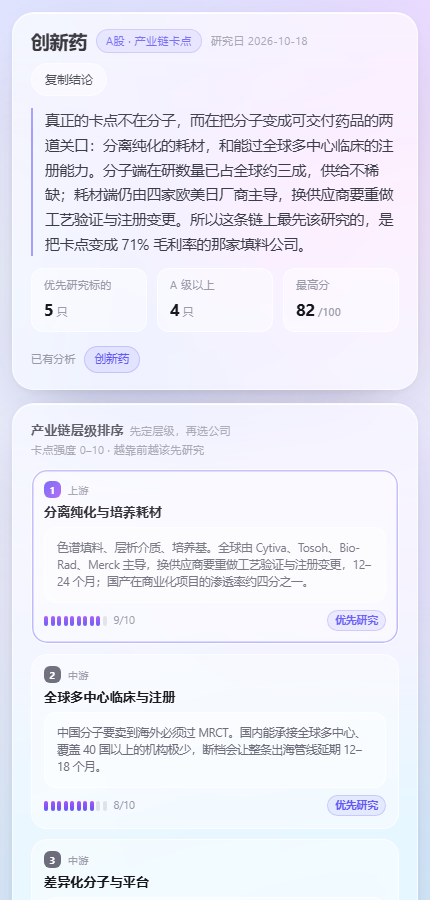

# chain-score · 产业链卡点评分

> 输入一个赛道、产品、热点或事件，输出一份**能点回原文**的单文件 HTML 研究报告：
> **先排产业链层级（哪一层最卡），再给 3–5 只优先研究标的，五维打分排名。**

仓库含两个技能：**chain-score**（交付层：排层级 + 五维评分 + 出报告）与 **serenity-skill**（方法论层：完整的产业链深度研究流程）。两者共用同一套评分规则与报告模板，可以只装一个。

装好之后，把 **[PROMPTS.md](PROMPTS.md)** 里的一段**整段复制**进对话框就能跑，不用记参数。

**一行装好（macOS / Linux）**

```bash
curl -fsSL https://raw.githubusercontent.com/dzp181/chain-score-skill/main/install.sh | bash
```

Windows 用[快速开始里的那条](#快速开始)。装完重启客户端即可。

[](LICENSE)
[](#快速开始)
[](#输出长什么样)



---

## 它解决什么问题

看到一个热点（CPO、HBM、固态电池、创新药出海、某厂断供），你能感受到热度，但不知道从哪儿下手：

| 你现在的状态 | chain-score 给你的 |
|---|---|
| 全网都在说，不知道先看哪个环节 | 把链条拆成 3–5 层，按「明天断供，下游多久能恢复」排卡点强度 |
| 一堆概念股，分不清谁是真的 | 3–5 只标的，每只标明在**哪一层**、卖什么、商业阶段（研发/送样/认证/量产/订单/确认收入） |
| 研报说了很多，不知道信不信 | 每条证据带日期 + 来源 + 原文链接，取不到就写 `[MISSING]`，不估算 |
| 分数怎么来的？ | 每个维度可点开看：分数带 / 计入得分的事实 / 未计满的原因 / 为什么停在这一档 |
| 财报和逻辑对不上 | 财务口径表专门用来暴露矛盾（高分但营收负增长、利润靠非经常性收益） |

一句话：**它不替你决策，它把「该先研究谁」排好序，并把每一分的出处摆在你能点开的地方。**

---

## 两个技能，怎么选

| | `chain-score` | `serenity-skill` |
|---|---|---|
| 定位 | 交付层：一进一出，直接出报告 | 方法论层：完整研究流程与对话协议 |
| 适合 | 已经知道要看哪条链，要一份能转发的评分报告 | 从零开始做主题研究，需要追问、挑战、逐步收敛 |
| 干的事 | 拆层级 → 选标的 → 五维打分 → 填模板交付 | 热点扫描 → 需求定位 → 卡点拆解 → 公司验证 → 证据分级 |
| 一次要多久 | 短（一次对话出结果） | 长（可分多轮推进） |
| 输出 | 单文件 HTML 评分报告 | 研究报告 + 判断依据 |
| 怎么叫 | `@skill:chain-score HBM` | `@skill:serenity-skill 帮我研究 HBM` |

两个技能共用同一套模板（`assets/report-template.html`）与同一套五维评分规则（`references/scoring-rubric.md`），所以排版和分数口径完全一致。**拿不准就先装 chain-score**，它更轻、更快；需要深挖时再上 serenity-skill。

---

## serenity-skill 指引（方法论层）

`serenity-skill` 是上游的独立开源项目，本仓库里这份是原样放进去的（未删改），用来补足「从热点到结论」的完整研究流程。

- **上游仓库**：<https://github.com/muxuuu/serenity-skill>
- **许可**：MIT（Copyright 2026 muxu），见 [skills/serenity-skill/LICENSE](skills/serenity-skill/LICENSE)
- **方法论来源**：Serenity / [@aleabitoreddit](https://x.com/aleabitoreddit) 的公开研究路径
- **定位**：这是独立实现的公开方法论项目，不是官方产品

### 单独安装（只想要方法论层，或想拿最新版）

```bash
git clone --depth 1 https://github.com/muxuuu/serenity-skill.git ~/.workbuddy/skills/serenity-skill
# Claude Code 换成 ~/.claude/skills/serenity-skill
```

上游更新了想拿新版，把它换成上游的 `git pull` 即可；本仓库里的这份不会自动同步。

### 里面有什么

| 目录 | 内容 |
|---|---|
| `SKILL.md` | 入口：请求路由（主题扫描 / 挑战公司 / 候选对比 / 学习模式）+ 研究流程 |
| `references/` | 10 篇：研究流程、证据阶梯、市场来源手册、**对话协议**、输出风格、风险合规、公开画像评估、评分规则、报告规范 |
| `examples/` | 3 个示例对话，看它怎么一步步收敛 |
| `assets/` | 同一套报告模板 + Prompt 包 + 论点模板 |
| `scripts/validate_skill.py` | 技能结构校验脚本 |

### 两种典型用法

**主题扫描**（从零开始，先不给股票）

```
用 serenity-skill 帮我研究 [主题]。
先拆产业链，判断哪些环节更接近真实供需瓶颈，先不要给股票。
证据不足就说不足，不要凑数。
```

**挑战一家公司**（把标签拆成可验证的主张）

```
用 serenity-skill 挑战 [公司名/代码]。
把它「XX 核心供应商」这个标签拆成具体主张，逐条对着公告和财报验证。
```

它默认一次只问一个聚焦问题、慢慢收敛——这不是效率低，而是防止一上来就给你一个看起来很完整的错误答案。

### 和 chain-score 接力

两个技能可以串起来用：

1. 先用 `serenity-skill` 深挖，得到 3–5 家候选和证据链
2. 再发一句：`用 chain-score 给上面这几家打分，出一份 HTML 报告`
3. chain-score 复用同一套模板与评分规则，直接出可转发的报告

### 校验结构（可选，需要 Python 3）

```bash
cd ~/.workbuddy/skills
python serenity-skill/scripts/validate_skill.py chain-score
python serenity-skill/scripts/validate_skill.py serenity-skill
```

两条都返回 `OK: <名称> (N description chars)` 就说明结构没问题。校验脚本只放在 serenity-skill 里，校验 chain-score 时指向它即可。

---

## 快速开始

### 第 0 步：确认环境

你需要一个**支持 Agent Skill 的客户端**，且该 Agent 具备联网搜索或读取公告/财报的能力（技能本身不带数据源）。

| 客户端 | 技能目录 | 状态 |
|---|---|---|
| WorkBuddy | `~/.workbuddy/skills/` | 已验证 |
| Claude Code 及同格式客户端 | `~/.claude/skills/`（以各自文档为准） | 格式兼容 |

> Windows 下 `~` 指 `C:\Users\<你的用户名>`，macOS 下指 `/Users/<你的用户名>`。
> 只想给单个项目用，就放到项目根目录的 `.workbuddy/skills/`。

### 方式一：一行命令（推荐，不用 git、不用下载）

**macOS / Linux** —— 复制这一行回车：

```bash
curl -fsSL https://raw.githubusercontent.com/dzp181/chain-score-skill/main/install.sh | bash
```

**Windows**（PowerShell，复制这一整段回车）：

```powershell
irm https://raw.githubusercontent.com/dzp181/chain-score-skill/main/install.ps1 -OutFile "$env:TEMP\cs.ps1"; powershell -ExecutionPolicy Bypass -File "$env:TEMP\cs.ps1"
```

脚本会自动从 GitHub 拉取仓库、把两个技能装到 `~/.workbuddy/skills/`，跑完**直接把可复制的提示词打在屏幕上**，重启客户端就能用。

想装到别处或只装一个，在后面加参数：

```bash
# macOS / Linux：只装交付层
curl -fsSL https://raw.githubusercontent.com/dzp181/chain-score-skill/main/install.sh | bash -s -- --only chain-score

# Windows：只装交付层，并复制提示词到剪贴板
irm https://raw.githubusercontent.com/dzp181/chain-score-skill/main/install.ps1 -OutFile "$env:TEMP\cs.ps1"; powershell -ExecutionPolicy Bypass -File "$env:TEMP\cs.ps1" -Only chain-score -Copy
```

### 方式二：git clone（想跟着更新走这条路）

```bash
git clone https://github.com/dzp181/chain-score-skill.git /tmp/cs && bash /tmp/cs/install.sh
```

```powershell
git clone https://github.com/dzp181/chain-score-skill.git $env:TEMP\cs
powershell -ExecutionPolicy Bypass -File $env:TEMP\cs\install.ps1
```

装到 Claude Code 或自定义目录：

```bash
bash /tmp/cs/install.sh ~/.claude/skills     # 换目录
bash /tmp/cs/install.sh --only chain-score   # 只装交付层
bash /tmp/cs/install.sh --copy               # 装完把提示词放进剪贴板
```

### 方式三：完全手动（下载 ZIP）

1. 点右上角 **Code → Download ZIP**
2. 解压，把 `skills/` 下的**两个文件夹**（`chain-score` 和 `serenity-skill`）一起拷到上表的技能目录
3. 重启客户端

最终结构必须是：

```
<技能目录>/
├── chain-score/
│   ├── SKILL.md
│   ├── assets/report-template.html
│   └── references/*.md
└── serenity-skill/
    ├── SKILL.md
    ├── assets/  references/  examples/  scripts/
```

只想要轻量版，就只拷 `chain-score`，它自包含、不依赖另一个。

> 三种方式结果一样：默认装两个技能，遇到同名目录会先备份成 `<技能名>.bak.<时间戳>` 再覆盖，不会静默删除你已有的改动。`--copy` / `-Copy` 会把提示词直接放进剪贴板。完整提示词库见 [PROMPTS.md](PROMPTS.md)。

### 最后一步：验证装好了

重启客户端，然后把这段贴进去：

```
@skill:chain-score CPO 光模块
请先排产业链层级（卡点强度 0-10，先定层级再选公司），再给 3-5 只优先研究标的，
按五维评分从高到低排序：卡脖子强度 30 / 下游覆盖 25 / 竞争格局 20 / 预期差 15 / 壁垒议价 10。
每个维度的得分点、扣分点、为什么停在这一档都要能点开看；
证据带日期、来源名和原文链接，查不到标 [MISSING] 不要估算；
财务口径用同一报告期同一口径，取不到写 —。
最后交付单文件 HTML。
```

能开始拆层级、最后吐出一个 HTML 文件，就说明装好了。

其他客户端把第一行换成 `用 chain-score 研究 CPO 光模块` 即可，其余照抄。

---

## 怎么用

### 三种客户端写法，复制即用

| 客户端 | 复制这句 |
|---|---|
| WorkBuddy | `@skill:chain-score CPO 光模块` |
| WorkBuddy（技能没被自动发现时） | `@skill:"C:\Users\<你的用户名>\.workbuddy\skills\chain-score\SKILL.md" CPO 光模块` |
| Claude Code / 其他客户端 | `用 chain-score 研究 CPO 光模块` |

只要主题名换成你关心的赛道/产品/热点/事件就行：`HBM`、`AI 电源`、`固态电池 干法电极`、`某厂断供事件`、`创新药出海`。

**想要一份完整、可直接发的报告**，用这段（把要求写清，结果更稳）：

```
用 chain-score 研究 CPO 光模块，看 A 股。

要求：
1. 先把产业链拆成 3–5 层，按「明天断供，下游多久能恢复」给 0–10 卡点强度，
   排完层级再选公司，不要跳过层级直接列股票。
2. 选 3–5 只标的，至少覆盖两个不同层级；每只写清卖什么、卖给谁、
   处在哪个商业阶段（研发/送样/认证/小批量/量产/订单/确认收入）。
3. 五维打分：卡脖子强度 30 / 下游覆盖 25 / 竞争格局 20 / 预期差 15 / 壁垒议价 10，
   执行封顶规则，给出定级。
4. 每个维度都要能点开看得分点、扣分点，以及「为什么不是上一档也不是下一档」。
5. 财务口径表：市值、PE(TTM)、营收同比、净利同比、毛利率及变动、现金流÷净利，
   同一报告期同一口径，取不到写 —，不要估算。
6. 证据带日期、来源名和原文链接；查不到标 [MISSING]，区分「已查未见」和「不存在」。
7. 交付单文件 HTML，能直接双击打开。
```

更多场景（挑战某家公司、方法论层怎么分两次问、提示词里该写什么不该写什么）见 **[PROMPTS.md](PROMPTS.md)**。

### 可以补的指令（不写就走默认）

| 你想说的 | 写法 |
|---|---|
| 换市场 | `也看美股` / `只看 A 股` |
| 改权重 | `权重改成 卡脖子 40 / 下游 20 / 竞争 15 / 预期差 15 / 壁垒 10`（必须加总 100） |
| 跳过选股 | `只给中际旭创、天孚通信打分` |
| 收窄主题 | `太宽了，收窄到 1.6T 光模块和硅光` |
| 换视角 | `重点看设备端` / `重点看材料端` |

主题太宽（比如只丢一个「AI」）时，技能会自动收窄到最有卡点的 2–3 个子环节，并**在报告里写明收窄理由**，不会偷偷替换你的问题。

### 适合问的 / 不适合问的

| 适合 | 不适合 |
|---|---|
| 「这条链上该先看谁」 | 「明天哪只涨」（技能不预测价格） |
| 「这家公司到底卡在哪一层」 | 「这只票能买吗」（不给买卖建议） |
| 「帮我排个研究顺序」 | 「帮我算一下 DCF」（用 `@skill:dcf-model-builder`） |
| 「这个热点是真需求还是炒概念」 | 「给我一份行业综述」（用 `sector-overview`） |

---

## 输出长什么样

一个**自包含 HTML 文件**，双击就能开，无 CDN、无外部图片、无接口依赖，可以直接发给不用 AI 的同事看。

版面顺序固定：主题概览 → 产业链层级排序 → 财务口径 → 标的榜 + 详情。



| 区块 | 内容 |
|---|---|
| 主题概览 | 一句话结论（真正的卡点在哪）、标的数 / A 级以上 / 最高分、复制结论按钮 |
| 产业链层级排序 | 3–5 层，卡点强度 0–10，标注 优先研究 / 跟踪 / 观察 / 不优先 |
| 财务口径 | 11 列表格，同一报告期、同一估值口径，用来验证分数而不是给分 |
| 标的榜 | 按综合分从高到低，跨层级分布 |
| 标的详情 | 分数环 + 定级、五维卡片（**点击展开得分明细**）、核心洞察、产业链位置、排序理由、证据链、主要风险、失效条件、关键观察位、数据缺口 |

手机端单列自适应：



两份真实样例（点开可以直接看，不需要装任何东西）：

- [A 股 · 创新药](examples/demo-a-share-innovative-drug.html)
- [美股 · 创新医药](examples/demo-us-biotech.html)

---

## 评分规则

总分 100，五维：

| 维度 | 权重 | 判什么 |
|---|---:|---|
| 卡脖子强度 | 30 | 明天断供，下游多久能恢复 |
| 下游覆盖 | 25 | 服务多少个正在花钱的终端 |
| 竞争格局 | 20 | 供给端有没有纪律 |
| 预期差 | 15 | 和共识差在哪一件可验证的事 |
| 壁垒议价 | 10 | 卡点能不能变成毛利和现金流 |

**封顶规则**（强制，页面上会显示「原始 → 封顶 + 原因」）

| 触发条件 | 封顶 |
|---|---:|
| 卡脖子强度 ≤ 10 | 55 |
| 下游覆盖 ≤ 8 | 65 |
| 预期差 ≤ 5 且竞争格局 ≤ 10 | 60 |

**定级**：≥80 **S 核心研究** ｜ 65–79 **A 重点跟踪** ｜ 50–64 **B 观察名单** ｜ <50 **C 暂缓**

**打分纪律**（写进技能，防止分数是拍出来的）

1. 先写证据再给分，禁止先定分数再找理由
2. 分差 ≥ 3 必须能说出「差在哪一件事实」
3. 同一主题内同一把尺子，跨主题分数不可比
4. 缺证据记 0 并标 `[MISSING]`，不代为估算
5. 每只标的 × 每个维度都要写得分明细，`verd` 必须回答「为什么不是上一档，也不是下一档」
6. 分数是**研究排序**，不是预期收益

---

## 为什么结果可以核对

它把「研究」拆成了可检查的东西，而不是一段看着像那么回事的文字：

- **层级先于公司**。先判断哪一环断供最疼，再在这一环里找公司。跳过层级直接列股票，等于跳过研究给答案。
- **层级分和公司分是两把尺子**。层级 0–10 只看环节，公司卡脖子 30 分才看份额和议价。所以报告里会出现「层级第 1、公司排第 4」这种结论，并解释原因。
- **证据分级**。公告 > 交易所文件 > 财报电话会 > 互动易 > 媒体 > 券商观点，强弱不同权重不同，`[MISSING]` 与「已查未见」是两件事。
- **财务表专门找矛盾**。现金流÷净利 < 0.6、毛利率下滑却给高分——发现就要在洞察里解释，或者下调分数，不允许两张表各说各话。
- **口径不一致会明说**。个股报告期不同、PE 失真（比如归母被投资收益扭曲）、ADR 流动性差，都会写进表脚注，不混在一起算。

---

## 目录结构

```
.
├── README.md                       # 你正在看的这份
├── PROMPTS.md                      # 提示词库：三种客户端写法 + 常用场景，可整段复制
├── docs/                           # 3 张预览图
├── examples/                       # 2 份真实报告（A股创新药 / 美股创新医药）
│
├── skills/
│   ├── chain-score/                    # 交付层：排层级 + 评分 + 出报告
│   │   ├── SKILL.md                    # 5 步流程、评分纪律、交付规范
│   │   ├── assets/
│   │   │   └── report-template.html    # 报告模板（数据与视图分离，73KB 单文件）
│   │   └── references/
│   │       ├── scoring-rubric.md       # 五维分数带、封顶、反作弊条款
│   │       ├── html-report-spec.md     # 版面、数据模型、交互、自检清单
│   │       ├── evidence-ladder.md      # 证据强弱分级
│   │       ├── market-source-playbook.md  # 各市场去哪儿找原始文件
│   │       └── deep-research-workflow.md  # 研究步骤
│   │
│   └── serenity-skill/                 # 方法论层：完整研究流程与对话协议
│       ├── SKILL.md
│       ├── LICENSE                     # 上游 MIT 许可（Copyright 2026 muxu）
│       ├── assets/                     # 同一套报告模板 + Prompt 包 + 论点模板
│       ├── references/                 # 含对话协议、输出风格、风险合规、公开画像等
│       ├── examples/                   # 3 个方法论示例对话
│       └── scripts/validate_skill.py   # 技能结构校验脚本
│
└── install.sh  install.ps1             # 一键安装（装完直接打印可复制的提示词）
```

两个技能的 `assets/report-template.html` **必须保持一致**（`cmp -s` 校验）。改模板时两边都要同步，否则一份报告用新模板、一份用旧模板。

### 想改成自己的模板？

模板只有三个数据对象，改它们就行，别动渲染逻辑：

```js
const REPORT = { themes: [{ id, name, date, verdict, layers, stocks, ... }] };
const SCORE_NOTES = { "688690.SH": { "卡脖子强度": { band, plus, minus, basis, verd } } };
const FIN = { "688690.SH": { px, mcap, pe, rev, np, gm, gmd, ocf } };
```

字段说明见 [references/html-report-spec.md](skills/chain-score/references/html-report-spec.md)。

---

## 边界

**会做**：产业链拆层、卡点排序、标的筛选、五维打分、证据溯源、矛盾暴露、单文件交付。

**不会做**：预测股价、给买卖点、算目标价、给仓位建议、编造检索不到的数字。

- 每个数字可追溯，缺失标 `[MISSING]`，超过 90 天标 `[STALE]`
- 关键观察位写的是估值锚与失效位，不是买卖点
- 涉及内幕或未公开信息一律拒绝
- 报告页脚固定：**本报告仅供研究参考，不构成个人投资建议**

---

## 常见问题

**装完之后没有任何反应？**
技能是客户端启动时扫描的，必须**重启客户端**。另外确认目录层级是 `<技能目录>/chain-score/SKILL.md`，不要多套一层文件夹。

**为什么它说「未收录」或数据查不到？**
技能不带数据源，靠宿主的联网能力。若 Agent 无法联网，或目标公司刚上市、信披很少，会把缺口写进「数据缺口」而不是编一个数。

**分数能跨主题比较吗？**
不能。同一主题内同一把尺子，跨主题不可比。82 分只在这一次报告里有意义。

**为什么阿里拉姆（ALNY）只有 58 分却最值得看？**
它的预期差最大（股价 -55% vs 收入 +106%），但「药」这个环节的卡点本质是疗效竞争，医生可以换药，所以卡脖子强度只给 12 分。分数低是卡点弱，不是没机会。这正是分成五个维度的原因——见[美股样例](examples/demo-us-biotech.html)。

**能出英文报告吗？**
版面是中文的。改 `SKILL.md` 里的输出语言要求即可，模板文案需要自己替换。

**和 serenity-skill 什么关系？**
方法论同源，chain-score 是它的交付层拆分：只做「排层级 + 评分 + 出报告」，更轻、更快、可复用。serenity-skill 保留完整的研究流程（热点扫描、需求定位、追问协议、公开画像评估），适合从零做深度研究，上游在 [muxuuu/serenity-skill](https://github.com/muxuuu/serenity-skill)。两个技能共用同一套模板与评分规则，可以只装一个，也可以都装。详见[两个技能怎么选](#两个技能怎么选)与[serenity-skill 指引](#serenity-skill-指引方法论层)。

---

## 方法论来源

- 产业链瓶颈研究的公开方法论脉络来自 **Serenity / [@aleabitoreddit](https://x.com/aleabitoreddit)**：从热点出发拆链条，找难以扩产、难以替代的环节，再回到公司用公告与财报验证。
- 方法论层的实现来自上游开源项目 **[muxuuu/serenity-skill](https://github.com/muxuuu/serenity-skill)**（MIT），本仓库 `skills/serenity-skill/` 为原样收录。
- 五维评分框架、封顶规则、得分明细要求，是在此基础上固化的可执行口径，细则见 [references/scoring-rubric.md](skills/chain-score/references/scoring-rubric.md)。
- 技能的目录结构与校验脚本沿用 Agent Skill 约定。

---

## License

本仓库代码与文档以 [MIT](LICENSE) 授权，可自由使用、修改、商用，保留版权声明即可。

其中 `skills/serenity-skill/` 来自上游项目，**保留其原始 MIT 许可与版权声明**（见 [skills/serenity-skill/LICENSE](skills/serenity-skill/LICENSE)，Copyright (c) 2026 muxu），未做删改。若上游有更新，以原项目为准。

**免责声明**：本项目是研究辅助工具，输出为研究排序与证据整理，不构成任何证券投资建议。据此操作的盈亏由使用者自行承担。市场有风险，决策请独立判断。
